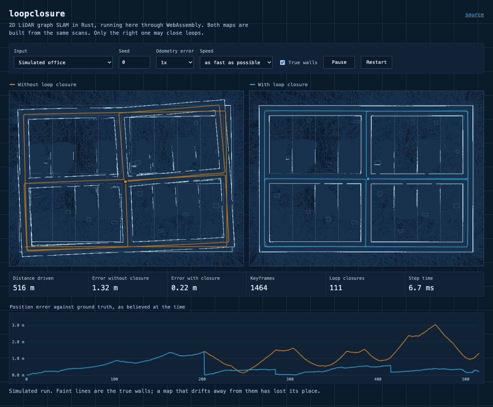
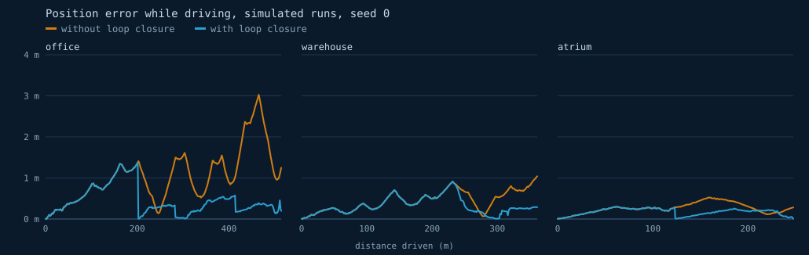
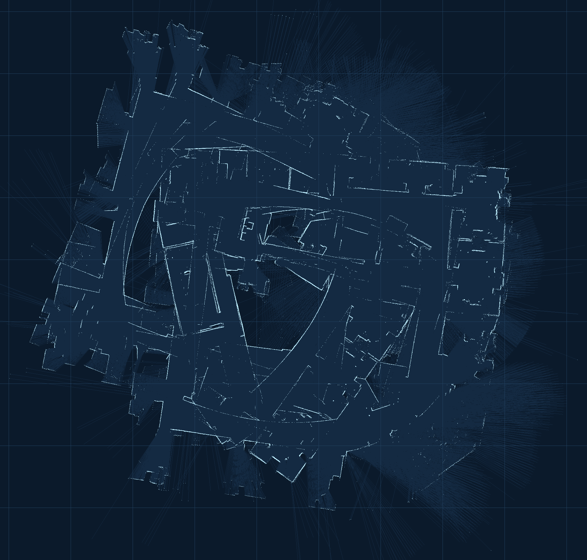
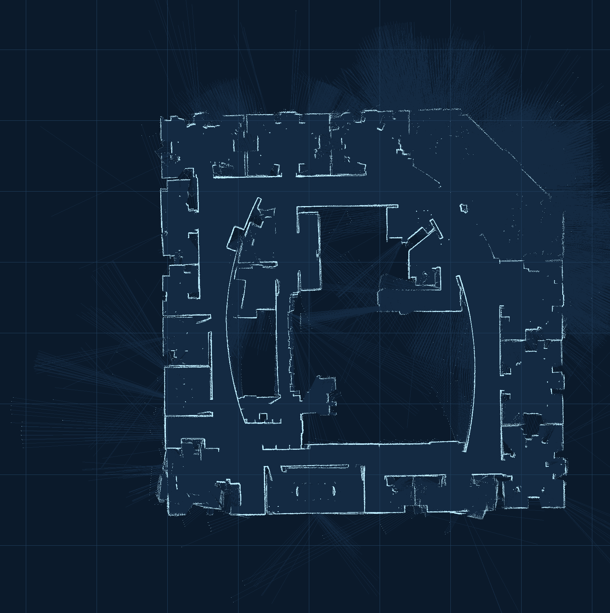
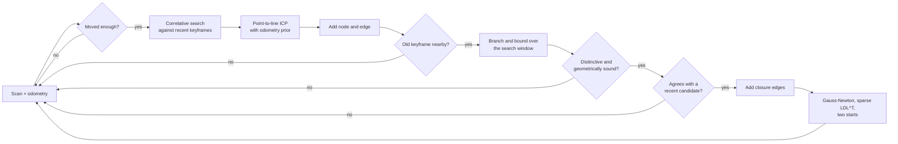
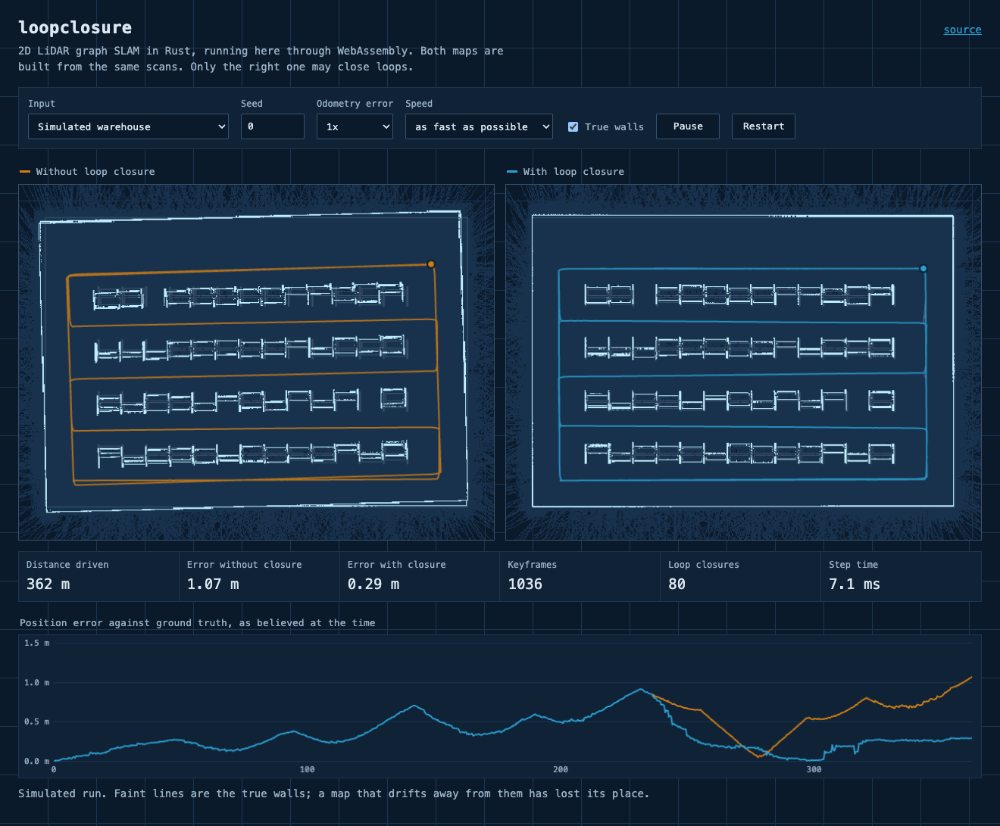
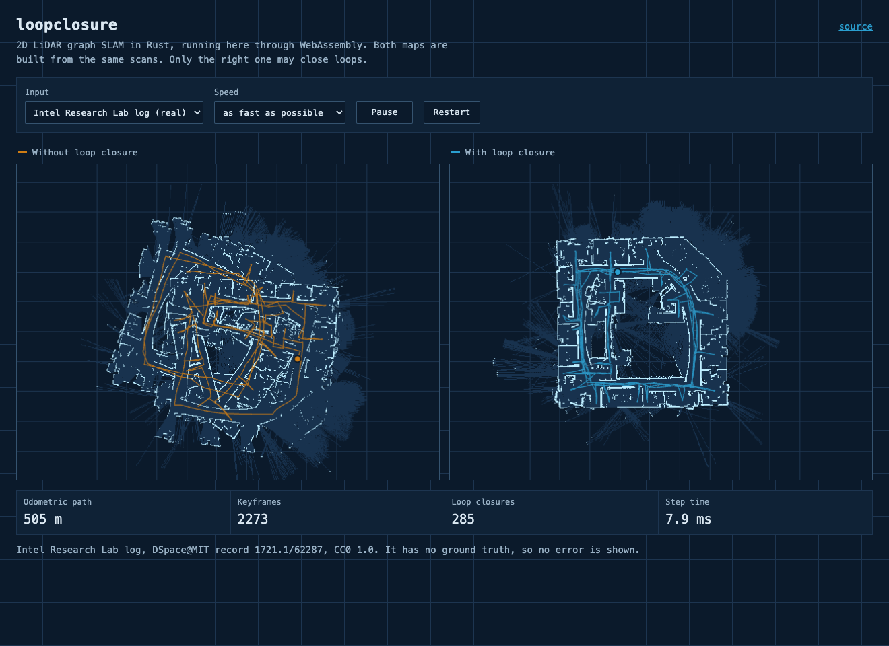

# loopclosure

[](https://github.com/matejpopovski/loopclosure/actions/workflows/ci.yml)

2D LiDAR graph SLAM written from first principles in Rust: scan matching, a pose graph, loop closure and a sparse Cholesky solver, with no SLAM or linear algebra crates. The same code compiles to WebAssembly, so the map can be [built live in your browser](https://matejpopovski.github.io/loopclosure/).

**Over 22.5 km of simulated driving, loop closure cuts drift from 0.33 m to 0.08 m.** That is mean ATE RMSE against simulator ground truth, across 60 runs on seeds outside the tuning set. Closure won on all 60 runs and put no false edge in any graph. Raw odometry on the same runs: 5.68 m.



Both maps above were built in the browser from the same scans. The faint lines are the true walls. The left map has only scan matching to go on, and it skews. The right map has been closing loops since the 200 m mark, where the chart shows its error dropping.

## Drift, with and without

All values below are **simulator measurements** against simulator ground truth. Three worlds, seeds 0 to 19 each. Each cell is the mean over 20 runs, with the worst run in brackets.

| World | Path | ATE RMSE, odometry | ATE RMSE, no closure | ATE RMSE, closure | Worst drift, no closure | Worst drift, closure |
|---|---|---|---|---|---|---|
| office | 516 m | 9.25 m (26.68) | 0.61 m (1.27) | **0.11 m** (0.32) | 2.31 m (5.16) | **0.40 m** (1.15) |
| warehouse | 362 m | 4.21 m (14.12) | 0.17 m (0.29) | **0.08 m** (0.11) | 0.85 m (1.47) | **0.29 m** (0.51) |
| atrium | 248 m | 3.56 m (9.67) | 0.20 m (0.56) | **0.04 m** (0.10) | 0.63 m (1.62) | **0.17 m** (0.34) |
| all 60 runs | 375 m | 5.68 m (26.68) | 0.33 m (1.27) | **0.08 m** (0.32) | 1.26 m (5.16) | **0.29 m** (1.15) |

"Worst drift" is the largest position error at any point of the final trajectory, pinned at the start pose with nothing fitted to the truth. ATE is after a best-fit rigid alignment. Reproduce with `loopclosure drift --seeds 20` ([results/drift.json](results/drift.json)).



This figure shows what the robot believed at each moment, which is less flattering than the tables. Before the first revisit, closure has nothing to work with and the two lines are the same. Mean worst error while driving falls only from 1.28 m to 0.72 m (2.79 m at worst), because that peak is usually reached on the first pass.

Closure is not free locally either. It adds tension, and over 1 m segments the relative error is slightly worse with it: 0.015 m against 0.014 m overall, and 0.017 m against 0.013 m in the warehouse. Over 10 m segments the two are level.

## The real building

The Intel Research Lab log is a long-standing public test for this problem: a robot with a 180-beam SICK scanner covers about 505 m of one floor in 45 minutes, on odometry far too poor to map from. The log has no ground truth, so no ATE is reported for it. This is what comes out, with the same settings as the simulator:

| Without loop closure | With loop closure |
|---|---|
|  |  |

Grid lines are 5 m apart. To put a number on the difference without truth, this project measures how often a wall seen on one pass is where another pass saw it. Among points from a later pass, the share lying within 5 cm of a wall from an earlier pass:

| Trajectory | Agreement between passes |
|---|---|
| raw odometry | 0.9% |
| scan matching, no closure | 1.9% |
| with loop closure | **53.7%** |

Points that see something the earlier pass did not count as misses, so 100% is out of reach. The value only means something relative to another trajectory scored on the same 258 pairs of keyframes. It comes from `loopclosure replay data/intel.script.gz` ([results/intel.json](results/intel.json)), which replays the 45-minute log in 6 s on one core of an Apple M3 Max, 450 times faster than real time, with 285 closures from 304 attempts.

## Why this is hard

**Scan matching cannot see along a corridor.** Two parallel walls look the same wherever you stand between them. The matcher's Hessian says so, with one eigenvalue near zero, but a naive pipeline ignores that and takes the noise-driven answer anyway. Worse, if the whole map stretches evenly, the loop still closes: every side of the office ring is long by the wheel scale error, and the ring stays consistent. The office keeps the largest error of the three worlds, and its worst runs show this pattern.

**A true closure looks like an outlier.** After a long drive, a correct match disagrees with the current estimate by metres, which is what a false match looks like too. This is the problem that took the most work here, covered below.

**Everything looks like everything else.** Warehouse aisles repeat every 6 m and bays every 2.7 m. A search window wider than that matches a place the robot has never visited to the aisle next door, consistently, scan after scan.

**Loop closure destroys sparsity.** A pose graph in time order is banded until a closure links two distant rows. Solved naively, each closure fills in the factor between them.

## How it works



The decisions that mattered, and what was turned down:

**Two matchers, in order.** A correlative search (Olson 2009) scores every pose in a window against a likelihood field, so it cannot be trapped in a local minimum, but its answer is quantised. ICP is the reverse. Using the first to seed the second gets both. The search uses the multi-resolution branch and bound of Hess et al. (2016), and a test confirms that it returns the same optimum as plain enumeration. ICP alone was rejected because a loop closure's initial error is far outside its basin of convergence.

**Odometry goes into the match, not next to it.** ICP runs with the odometry prediction as a Gaussian prior, so a corridor's unobservable direction stays on the prediction rather than following the noise. The match Hessian then becomes the edge's information matrix, rotated from the world frame into the edge's frame. A corridor therefore reaches the back end as an edge that is stiff across the corridor and soft along it, which lets a later closure slide the chain along its axis without tearing it.

**The query is a few metres of history, not one scan.** One scan of a corridor matches any other. The last 30 keyframes see a sequence of doors. The target is every old keyframe within 10 m, from any visit.

**Two starts, one objective.** A tight robust kernel treats a correct but distant closure as an outlier and switches it off, so the map never closes. Graduated non-convexity (Yang et al. 2020) fixes that by starting wide and tightening, but it also lets false closures do lasting damage. Rather than pick one, each optimisation runs both from the same initial guess and keeps whichever ends at the lower cost under the tight kernel. Both are descending the same objective, so the comparison is fair. On the Intel log the tight start alone reaches 30.4% agreement between passes and the pair reaches 53.7%. With false closures injected into finished graphs, the wide start alone is the one that suffers, as the table below shows. The price is a second optimisation per closure event.

**Block-level fill-reducing order.** Approximate minimum degree (Amestoy, Davis and Duff 1996) runs on the graph of 3x3 pose blocks, then expands to scalars. The factorisation is an up-looking sparse LDL^T after Davis (2005), with the symbolic phase split out so that Gauss-Newton iterations within one optimisation pay only for the numeric phase. A supernodal factorisation would be faster on large graphs, but this one is short and easy to check against a dense oracle, which the tests do.

Rejected outright: a Rao-Blackwellised particle filter, because memory scales with particles times map and it offers no global re-optimisation. An incremental solver such as iSAM2, because at this scale a full solve costs milliseconds and the batch solver is much easier to verify.

## Where it breaks

Loop search radius is the setting that decides everything in repetitive buildings, and it fails abruptly. In the warehouse, with aisles 6 m apart:

| Search radius | Mean ATE RMSE | Worst run | False closures, 10 runs |
|---|---|---|---|
| 2 m | 0.09 m | 0.11 m | 0 |
| 3 m | 0.09 m | 0.11 m | 0 |
| 4 m (default) | 0.09 m | 0.11 m | 0 |
| 5 m | 0.09 m | 0.11 m | 0 |
| 6 m | 1.52 m | 3.36 m | 112 |
| 8 m | 2.49 m | 4.24 m | 162 |

At 6 m the search reaches the next aisle, the match is self-consistent, and the map folds. The default of 4 m sits below that limit, but that is a fact about this building which the code does not know. The radius has to exceed the true drift and stay below the structure's repeat distance, and on some sites those two will conflict ([results/aliasing.json](results/aliasing.json)).

The other safeguards were each removed in turn. Mean ATE RMSE over 10 seeds per world, and false closures in the graph over all 30 runs:

| Removed | Search radius | office | warehouse | atrium | False closures |
|---|---|---|---|---|---|
| nothing | 4 m | 0.11 m | 0.09 m | 0.04 m | 0 |
| pairwise consistency check | 4 m | 0.11 m | 0.09 m | 0.04 m | 0 |
| runner-up ambiguity test | 4 m | **1.85 m** | 0.09 m | 0.04 m | 521 |
| robust kernel | 4 m | 0.11 m | 0.09 m | 0.04 m | 0 |
| wide optimiser start | 4 m | 0.11 m | 0.09 m | 0.04 m | 0 |
| nothing | 8 m | 0.11 m | **1.42 m** | 0.04 m | 155 |
| pairwise consistency check | 8 m | 0.11 m | **1.15 m** | 0.04 m | 111 |
| runner-up ambiguity test | 8 m | **1.45 m** | **1.42 m** | 0.04 m | 639 |
| robust kernel | 8 m | 0.11 m | **3.22 m** | 0.04 m | 306 |
| wide optimiser start | 8 m | 0.11 m | 0.09 m | 0.04 m | 34 |

Three things stand out, and not all of them flatter the design ([results/gates.json](results/gates.json)):

- The ambiguity test is the safeguard that earns its place. Without it, office corridors produce hundreds of false closures even at the default radius.
- The pairwise consistency check does little in these runs: it trims a few false closures at 8 m and changes nothing at 4 m. A false match in repeating structure agrees with the next false match, because both are off by the same bay. It stays in because it is cheap, and it held back 7 candidates on the real log.
- The last row is a real weakness. At 8 m in the warehouse, a tight kernel alone copes with 34 false closures, while the two-start selection takes the wide result and folds the map. False closures that agree with each other can lower the cost, and the objective then picks the wrong answer. Comparing costs does not solve this. Keeping the radius below the repeat distance does.

The back end was also tested by adding false closures to finished graphs, each wrong by up to 5 m and 0.6 rad but with the confidence of a good match. Mean ATE RMSE over 30 runs:

| False closures | No kernel | Huber | Cauchy | DCS, tight start | DCS, wide start | DCS, both starts |
|---|---|---|---|---|---|---|
| 0 | 0.08 m | 0.08 m | 0.08 m | 0.08 m | 0.08 m | 0.08 m |
| 10 | 2.67 m | 1.37 m | 0.10 m | 0.08 m | 0.65 m | 0.13 m |
| 50 | 2.59 m | 1.16 m | 0.17 m | 0.09 m | 0.77 m | 0.17 m |
| 200 | 2.56 m | 0.98 m | 0.23 m | 0.13 m | 0.86 m | 0.14 m |

Starting tight is best here, because these graphs have already converged, but tight alone is what fails on the real log. Taking both pays for that with up to 0.08 m of mean error, and in the worst single run 1.21 m against 0.39 m at 50 false closures ([results/outliers.json](results/outliers.json)).

## Solver timing

One Gauss-Newton solve on generated Manhattan-world graphs (a random walk on a grid that closes a loop at each revisit, in the style of M3500 but not that dataset). Median of 7 runs, single thread, Apple M3 Max, 36 GB, with other jobs running on the machine.

| Poses | Closures | Unknowns | Fill nnz(L), AMD | RCM | Time order | Solve, AMD | RCM | Time order | Dense |
|---|---|---|---|---|---|---|---|---|---|
| 500 | 240 | 1,497 | 20 k | 44 k | 192 k | 0.33 ms | 0.79 ms | 11.5 ms | 431 ms |
| 1,000 | 493 | 2,997 | 45 k | 154 k | 868 k | 0.70 ms | 4.8 ms | 111 ms | 4,615 ms |
| 3,500 | 1,981 | 10,497 | 213 k | 652 k | 12.2 M | 5.4 ms | 22.5 ms | 7,915 ms | not run |
| 10,000 | 6,741 | 29,997 | 786 k | 4.9 M | not run | 33 ms | 530 ms | not run | not run |
| 35,000 | 22,253 | 104,997 | 3.1 M | 34.0 M | not run | 184 ms | 6,780 ms | not run | not run |

Ordering is worth a factor of 1,460 at 3,500 poses, before any code is optimised. Time order was stopped at 3,500 poses and dense at 1,000 because each further size takes minutes per solve. Reverse Cuthill-McKee, which minimises bandwidth rather than fill, is a poor fit: a loop closure is a long-range link, and no ordering makes the band narrow. Symbolic analysis stays cheap, at 33 ms for AMD at 35,000 poses ([results/solver.json](results/solver.json)).

## In the browser

The WebAssembly module is 180 KB. In headless Chromium on the same machine, the whole 13,631-scan Intel log replays in 18 s through two SLAM instances, redrawing both maps as it goes, with a recent step time of about 8 ms per keyframe. The office run takes 13 s ([results/browser.json](results/browser.json)).

| Warehouse | Intel log, real data |
|---|---|
|  |  |

Each session runs two SLAM instances in lock step, so the page can show closure against no closure on identical input. It runs on the main thread with a 14 ms budget per animation frame rather than in a worker, which keeps the code short at the cost of an occasional dropped frame when a loop closes. The Intel option fetches the compressed log and unpacks it with the browser's `DecompressionStream`.

## Run it

The toolchain is pinned in `rust-toolchain.toml`.

```sh
cargo test --workspace

cargo run --release -p loopclosure-cli -- simulate --world office --seed 3 --map map.png
cargo run --release -p loopclosure-cli -- replay data/intel.script.gz --out results
```

Every number in this README comes from one of these, each writing to `results/`. Build the binary with `cargo build --release -p loopclosure-cli`, which puts it at `target/release/loopclosure`.

```sh
loopclosure drift --seeds 20     # results/drift.json, drift_curves.json
loopclosure gates --seeds 10     # results/gates.json
loopclosure aliasing --seeds 10  # results/aliasing.json
loopclosure outliers --seeds 10  # results/outliers.json
loopclosure solver --repeats 7   # results/solver.json
loopclosure figures              # results/figures/drift_curves.svg
```

To build and serve the demo, then run its browser tests:

```sh
./scripts/build_web.sh           # needs wasm-pack
python3 -m http.server 43180 --directory web

cd e2e && npm ci && npx playwright install chromium && npm test
```

## Layout

- `crates/core`: the `loopclosure` library. It has no dependencies.
- `crates/cli`: the `loopclosure` binary and all experiments.
- `crates/wasm`: `wasm-bindgen` bindings.
- `web`: the page, plain JavaScript with no build step.
- `e2e`: Playwright tests and the screenshot capture.

## Tuning and data

Settings were tuned on seeds 100 to 107 and on the real log. Published results use seeds 0 to 19. Two back-end decisions came later, after looking at seeds 0 to 9 and the real log in the ablations above: running both optimiser starts, and raising the DCS threshold from 10 to 100. The published tables are from the final code, but those seeds are not fully untouched. The simulator's noise model is this project's own assumption, not fitted to any robot: wheel scale error of 1.2% and heading bias of 0.003 rad/m (standard deviations, drawn once per run), 1.5 cm range noise, 2% dropouts, on a 271-beam, 10 m scanner. Details are in `results/drift.json`.

`data/intel.script.gz` is an unmodified copy from the `intel_lab` record in [Radish on DSpace@MIT](http://hdl.handle.net/1721.1/62287), author on record Dieter Fox, licence on record CC0 1.0. `scripts/fetch_intel.sh` downloads it again and verifies the published checksum. See [data/README.md](data/README.md) for how it was identified.

## Limitations

- The simulated worlds are static, and every wall is a zero-thickness segment. Door frames give no edge to match, so along-corridor information comes only through open doors. Moving objects are not simulated.
- No global relocalisation. The loop search assumes the estimate is within the search radius of the truth, so a robot that loses track badly, or is carried somewhere, will not recover.
- The search radius grows linearly with distance since the last closure. That is a stand-in for real uncertainty, not a computed covariance.
- Scale error along featureless corridors survives closure, because an evenly stretched ring still closes. The worst office runs show this pattern: the map is uniformly a little too small or too large.
- The scan-to-graph information scaling (`scan_effective_points`) is a tuned constant, not a calibrated covariance. Edges are not statistically consistent, so the graph's chi-squared has no meaning here.
- The occupancy map is rebuilt from every keyframe after closures, at a cost linear in the length of the run. The estimator itself never reads this grid.
- 2D only, and one floor. CARMEN `FLASER` parsing is covered by unit tests on hand-written lines only, since no real CARMEN log was verified for redistribution.
- Timings were taken on a shared machine while other jobs ran, so treat them as upper bounds with noise.
- There is no comparison with published results for this log. Published evaluations use hand-made relations that this project did not obtain, so `results/intel.json` holds only its own consistency measure.

## References

- Olson, "Real-Time Correlative Scan Matching", ICRA 2009.
- Hess, Kohler, Rapp and Andor, "Real-Time Loop Closure in 2D LIDAR SLAM", ICRA 2016.
- Grisetti, Kümmerle, Stachniss and Burgard, "A Tutorial on Graph-Based SLAM", IEEE ITS Magazine, 2010.
- Agarwal, Tipaldi, Spinello, Stachniss and Burgard, "Robust Map Optimization Using Dynamic Covariance Scaling", ICRA 2013.
- Yang, Antonante, Tzoumas and Carlone, "Graduated Non-Convexity for Robust Spatial Perception", RA-L 2020.
- Amestoy, Davis and Duff, "An Approximate Minimum Degree Ordering Algorithm", SIAM J. Matrix Anal. Appl., 1996.
- Davis, "Algorithm 849: A Concise Sparse Cholesky Factorization Package", ACM TOMS, 2005.
- Sturm, Engelhard, Endres, Burgard and Cremers, "A Benchmark for the Evaluation of RGB-D SLAM Systems", IROS 2012.

MIT licence. See [LICENSE](LICENSE).
